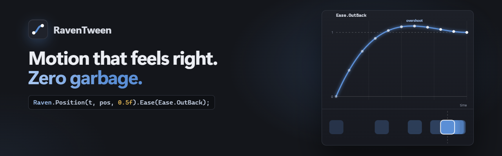
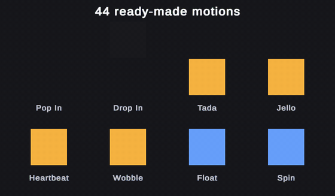
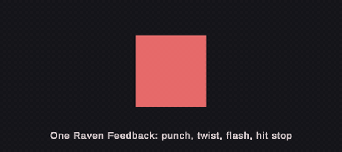
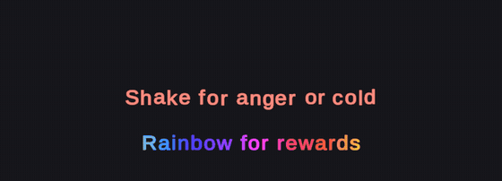
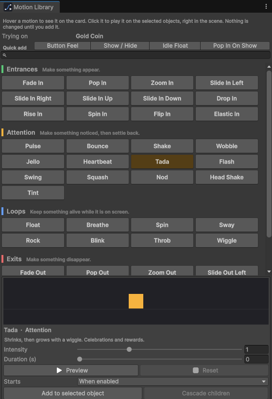
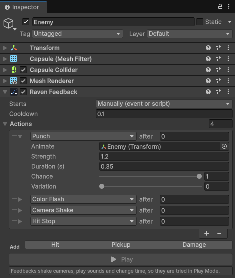
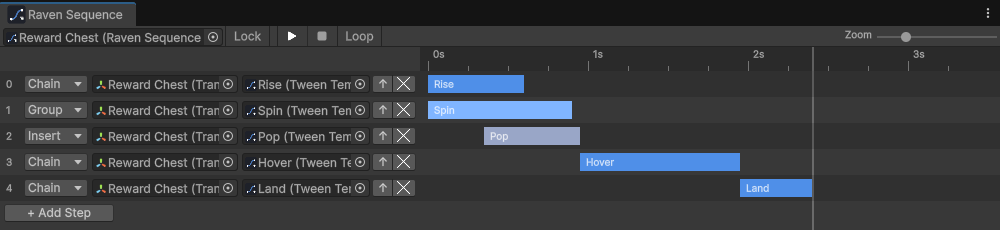

<p align="center">
  
</p>

<p align="center">
  <a href="https://github.com/Nekuzaky/RavenTween/actions/workflows/tests.yml"></a>
  
  
  
</p>

<p align="center">
  <a href="https://github.com/sponsors/nekuzaky"></a>
  <a href="https://buymeacoffee.com/nekuzaky"></a>
</p>

```csharp
using RavenTween;

Raven.Position(transform, target, 0.6f).Ease(Ease.OutQuad);

Raven.Sequence()
    .Chain(Raven.AnchoredPosition(panel, Vector2.zero, 0.5f).Ease(Ease.OutBack))
    .Group(Raven.Alpha(canvasGroup, 1f, 0.4f))
    .Chain(Raven.PunchScale(button, Vector3.one * 0.15f, 0.3f));

await Raven.Delay(1.2f);
```

**Or without a line of code — and without knowing animation.** Open the **Motion Library**, click *Pop In*, *Tada* or *Float* to watch it on the selected object, pick what starts it (showing up, a click, a hover, a trigger zone) and add it. **Raven Stagger** cascades menus in, **Raven Button Feel** makes buttons springy, **Raven Show Hide** runs popups, **Raven Feedback** adds shake, flash, sound and hit stop to any event, **Raven Path** moves objects along paths drawn in the scene, and for full control there are **Tween Templates** and a visual **Sequence Editor**. Same engine, same zero garbage.

<p align="center">
  
</p>

<p align="center">
  
  
</p>

<p align="center">
  
  
</p>

<p align="center">
  
</p>

- **0 B per frame** for property, effect, sequence and custom tweens — enforced by the test suite.
- **About 0.6 ms/frame** for 5,000 simultaneous tweens (desktop CPU, Editor, Mono).
- Sequences with timeline callbacks, shake & punch, TextMeshPro, async/await, coroutines, cancellation tokens.
- Full time control: elapsed time and progress you can read and set, per-tween time scale, `FixedUpdate` and Rigidbody tweens.
- Single-axis, speed-based and per-renderer property-block tweens; Incremental and PingPong cycles; tunable Overshoot / Bounce / Elastic eases.
- Procedural look-at and spring chains, plus optional Animation Rigging integration.
- No-code tools for designers: 44 ready-made motions with an animated Motion Library, Raven Motion (click, hover, trigger and collision starts, chaining), Raven Stagger, Raven Button Feel, Raven Show Hide, Raven Feedback (16 actions), Raven Path, Raven Typewriter, Raven Text Effect (per-letter), Raven Counter, shareable Motion Styles, Tween Templates with Edit Mode preview, and the visual Sequence Editor.
- Integrations: Unity Timeline track, UI Toolkit, UniTask, gamepad rumble, URP/HDRP volumes, Cinemachine impulses.
- A live **Tools → RavenTween → Monitor** window.
- A DOTween adapter: swap one `using` and most DOTween code runs on RavenTween.

<p align="center">
  
</p>

## Install

Package Manager → `+` → *Add package from git URL…*

```
https://github.com/Nekuzaky/RavenTween.git?path=/Packages/com.raventween.core#v1.7.1
```

**Updates are built in.** Once a day RavenTween checks for a newer release and offers to install it in one click — or installs it for you if you enable **Tools → RavenTween → Updates → Install Automatically**. The version tag in the URL keeps every teammate on the same release until someone updates on purpose. The check is one request to the GitHub releases API, from the Editor only, and sends nothing about your project; turn it off with **Tools → RavenTween → Updates → Check Automatically**. It never runs in a build, and Asset Store
installs are left to the Package Manager.

## Documentation

**[Read the manual at nekuzaky.com/docs/raventween](https://nekuzaky.com/docs/raventween)** — getting started, guides, procedural animation, designer tools, performance, migration from DOTween / PrimeTween, full API reference and FAQ. Its source lives in [`docs/wiki`](docs/wiki). The [package README](Packages/com.raventween.core/README.md) has a one-page API tour.

[Changelog](Packages/com.raventween.core/CHANGELOG.md) · [Contributing](Packages/com.raventween.core/CONTRIBUTING.md) · [Security](SECURITY.md) · MIT license

## Support

RavenTween is free and MIT licensed. If it saves you time, you can support its development through [GitHub Sponsors](https://github.com/sponsors/nekuzaky) or [Buy Me a Coffee](https://buymeacoffee.com/nekuzaky).

---

This repository is the development project. The package itself is in [`Packages/com.raventween.core`](Packages/com.raventween.core).
