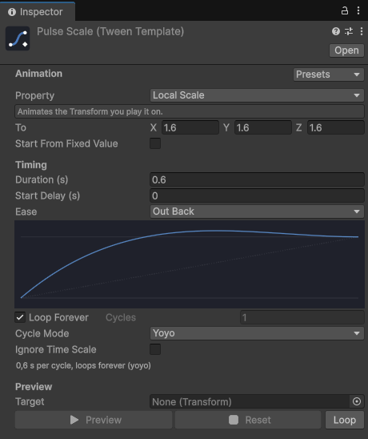
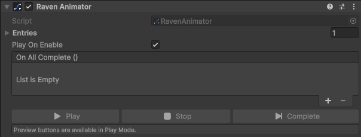
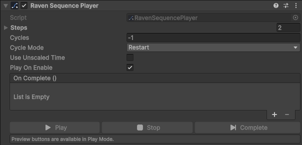

# Designer Workflow

Not every animation should live in code — and not everyone who animates should need to know what an easing curve is. RavenTween has two levels of no-code tools:

- **Motions** — for anyone. Pick a ready-made motion like *Pop In*, *Tada* or *Float* from a library, watch it play on your object, done. No animation knowledge needed.
- **Templates and timelines** — for when you want full control: your own **Tween Templates**, the **Raven Animator**, the **Raven Sequence Player** and the visual **Sequence Editor**.

Everything here runs on the same engine as the code API: the same zero-garbage tweens, the same easing, the same sequences.

---

## Your first animation — thirty seconds

1. Select an object in the Hierarchy (a UI panel, a button, a 3D object, a sprite).
2. Open **Tools ▸ RavenTween ▸ Motion Library** (or right-click the object ▸ **RavenTween ▸ Add Motion…**).
3. Click motions: each one plays on your object right away, in the scene, without changing anything.
4. When one feels right, choose when it **Starts** and press **Add to selected object**.
5. Press Play.

---

## Motions

A motion is a complete, tuned animation with a name you can guess: *Slide In Left*, *Heartbeat*, *Breathe*. Each one adapts to what it is put on — it moves UI in canvas pixels and scene objects in world units, fades Canvas Groups, Images, Texts and Sprite Renderers, and turns flat objects in the screen plane and 3D objects around their vertical axis. Every motion returns exactly to where the object started, so nothing ever drifts.

| Family | What it's for | Motions |
| :--- | :--- | :--- |
| **Entrances** | Make something appear. It is hidden at once, then revealed. | Fade In, Pop In, Zoom In, Slide In Left / Right / Up / Down, Drop In, Rise In, Spin In, Flip In, Elastic In |
| **Attention** | Make something noticed, then settle back. | Pulse, Bounce, Shake, Wobble, Jello, Heartbeat, Tada, Flash, Swing, Squash, Nod, Head Shake |
| **Loops** | Keep something alive while it is on screen. | Float, Breathe, Spin, Sway, Rock, Blink, Throb, Wiggle |
| **Exits** | Make something disappear. | Fade Out, Pop Out, Zoom Out, Slide Out Left / Right / Up / Down, Fall Out, Sink Out, Spin Out, Flip Out |

### Motion Library

**Tools ▸ RavenTween ▸ Motion Library** shows every motion on one page, grouped by family, with a search field. Select objects in the Hierarchy and click a motion to watch it on them — select several to see them cascade. **Intensity** and **Duration** sliders tune it live. Then:

- **Add to selected object** adds a **Raven Motion** with these settings and the chosen start.
- **Cascade children** adds a **Raven Stagger**: the motion plays on each child, one after another.
- **Quick add** has one-click setups: **Button Feel**, **Idle Float** and **Pop In On Show**.

Nothing is changed until you add something: previews always put the objects back.

### Raven Motion

**Add Component ▸ RavenTween ▸ Raven Motion** plays one motion on its object (or on the object in **Animate**).

| Setting | Meaning |
| :--- | :--- |
| **Motion** | Pick from the grouped menu; a sentence under it says what it looks like. **Browse all motions…** opens the library. |
| **When** | What starts it: *When enabled*, *When the scene starts*, *On click*, *On hover*, *When the pointer leaves*, *On press*, *On release*, *When something enters / leaves (trigger)*, *On collision*, or *Manually* (from any UnityEvent, such as another button's **On Click** → `RavenMotion.Play`). |
| **Only Tag** | For triggers and collisions: only objects with this tag count. |
| **Duration** | *Auto* uses the motion's own timing. |
| **Intensity** | 0.5 = subtle, 1 = as designed, 2 = exaggerated. |
| **Delay** | Seconds before it starts. An entrance hides the object during the delay. |
| **Distance** | Slides and drops only. *Auto* derives it from the object's size. |
| **Repeat** | Attention motions only: how many times in a row. |
| **Play While Paused** | Keep playing when `Time.timeScale` is 0 (pause menus). |
| **When Finished** | *Deactivate* or *Destroy* the object afterwards — typical after an exit. |
| **On Complete** | A UnityEvent fired when the motion ends. |

Press **Preview** to see it in the scene outside Play Mode; **Reset** puts the object back. The inspector also catches the usual mistakes and fixes them in one click: a fade on something that can't fade (**Add Canvas Group**), a click trigger without an Event System (**Create Event System**) or without a collider (**Add Box Collider**), a trigger collider that isn't set as a trigger, or a moving motion inside a Layout Group.

Several Raven Motions can share an object: an entrance plus a hover pulse plus an idle float is a common combination. A panel with **Slide In Up** *When enabled* and **Slide Out Down** *Manually*, *When Finished: Deactivate*, shows and hides itself properly with `SetActive(true)` and a Close button wired to the exit's `Play`.

### Raven Stagger

**Add Component ▸ RavenTween ▸ Raven Stagger** on a parent plays one motion on each child, **Interval** seconds apart — menus that cascade in, list rows, inventory slots, a row of coins. **Order** can run first-to-last, last-to-first, or from the center outwards. It works with Layout Groups: the layout is settled before the children's places are read.

### Raven Button Feel

**Add Component ▸ RavenTween ▸ Raven Button Feel** makes any button feel alive: it grows a little under the pointer, sinks when pressed and springs back when released. Pick a **Style** — *Subtle*, *Bouncy* (default) or *Juicy* — or *Custom* sizes and timing. It respects the Button's **Interactable** flag and keeps working in pause menus.

### From code

The same motions are one line away for programmers:

```csharp
Raven.Motion(panel, MotionPreset.SlideInUp);
coin.PlayMotion(MotionPreset.Float);
Raven.Motion(icon, MotionPreset.Tada, new MotionSettings { intensity = 1.5f, repeat = 2 });
```

`Raven.Motion` returns an ordinary `Sequence`: await it, chain it, stop it.

---

## Your own animations — two minutes

When no motion fits, build exactly what you want:

1. **Create ▸ RavenTween ▸ Tween Template**. In the new asset, open **Presets** and pick *Pop In*.
2. Select an object in the scene, then press **Preview** in the template: it plays right there, in Edit Mode. Adjust **Ease** and **Duration** until it feels right; **Reset** puts the object back.
3. On the object, **Add Component ▸ RavenTween ▸ Raven Animator**, add an entry, and drag the object and the template in.
4. Tick **Play On Enable**, or call **Play()** from a button's **On Click**.
5. Press Play.

For several animations in a row, use a **Raven Sequence Player** instead and press **Open Timeline** to arrange the steps visually:


---

## Tween Templates

A template is a reusable animation recipe saved as an asset. Create one with **Create ▸ RavenTween ▸ Tween Template**.



| Field | Meaning |
| :--- | :--- |
| **Property** | What to animate: position, scale, a single axis (`PositionY`, `ScaleX`…), alpha, color, field of view, a material property, a per-renderer property block… |
| **Material Property** | The shader property name, used by the material and property-block properties. `_Color` and `_BaseColor` work for either render pipeline. |
| **End Value** | Where to go. Uses `x` for single numbers, `xyz` for vectors and euler rotations, `xyzw` as RGBA for colors. |
| **Use Explicit From** / **From Value** | Start from a fixed value instead of the object's current one. |
| **Settings** | Duration, start delay, ease (or a custom curve), cycles or **Loop Forever**, cycle mode (Restart, Yoyo, Incremental, PingPong), unscaled time. |

The inspector is built to iterate quickly:

- **Presets** — pick *Pop In*, *Fade Out*, *Slide In From Left*, *Bounce Drop*, *Spin*, *Blink*, *Flicker* and more to fill every field at once, then adjust.
- **Fields that fit the property** — sliders for alpha and volume, a color picker for colors, euler angles for rotations, two components for UI positions.
- **Live curve** — the easing curve is drawn as you change it, with a summary of the total length underneath.
- **Preview** — choose a target (it's picked from the selection automatically), press **Preview**, and the animation plays on the scene object in Edit Mode. Drag the **Time** slider to scrub. **Reset** puts the object back exactly as it was. Values are also restored before entering Play Mode, before saving a scene, a prefab or an asset, and before quitting, so a preview never ends up saved. Editing the previewed object stops the preview first.

Because tweens themselves are single-use, a template is how you **reuse** an animation: every time it plays, it spawns a fresh tween. One `PopIn` template can serve every button in the game.

---

## Raven Animator

Plays one or more templates on scene objects. Add it with **Add Component ▸ RavenTween ▸ Raven Animator**.



1. Add an **Entry** per animation: drag the object to animate into **Target**, and the template into **Template**. The target can be the exact component the property needs (Transform, CanvasGroup, Image, Camera…) or simply the GameObject: the right component is found, and for material properties, the renderer's material.
2. Tick **Play On Enable** to play whenever the object is enabled, or call `Play()` from a button's **On Click** or any UnityEvent.
3. Use **On All Complete** to trigger something when every entry has finished.

All entries play at the same time. Disabling the object stops them. An entry also counts as finished when its tween is stopped from elsewhere or its target is destroyed, so **On All Complete** always fires once every entry has ended. A target that doesn't carry what the template animates logs an error and the entry is skipped.

---

## Raven Sequence Player

Builds a full timeline from templates. Add it with **Add Component ▸ RavenTween ▸ Raven Sequence Player**.



Each **Step** has a **Mode**:

| Mode | Plays |
| :--- | :--- |
| **Chain** | After everything before it. |
| **Group** | Alongside the previous step. |
| **Insert** | At **Insert Time** seconds from the start. |

The whole sequence takes **Cycles** (`-1` loops forever), **Cycle Mode** and **Use Unscaled Time**, and raises **On Complete** at the end. If no step is usable (all empty or incomplete), `Play()` raises **On Complete** immediately. Calling `Play()` from **On Complete** restarts the timeline cleanly. See **[Sequences](Sequences)** for how the three modes interact.

> [!IMPORTANT]
> To loop a timeline, set the **player's** Cycles to `-1` — not the templates'. A step whose template loops forever can't have a length on the timeline, so it plays once per sequence cycle: one out-and-back for a **Yoyo** template (it ends where it started), one pass for **Restart**. The inspector shows a warning on such steps.

### Sequence Editor

Press **Open Timeline** on a Raven Sequence Player (or use **Tools ▸ RavenTween ▸ Sequence Editor**) for a visual timeline:

- **One track per step**, colored by mode: Chain, Group or Insert. Steps whose template loops forever are marked, and incomplete steps are greyed out.
- **Drag a block** to move it in time — it becomes an *Insert* at that time. Moves snap to 0.05 s; hold **Alt** for free placement.
- **Edit in place**: change a step's mode, target or template, reorder with the arrow, add with **+ Add Step**, remove with the cross.
- **Scrub and play**: click or drag on the ruler to see the scene at any time, or press Play (optionally Loop). Stop restores the scene exactly.
- Every change supports **Undo**. The window follows the selection; **Lock** keeps it on one player.

> [!TIP]
> Both components show **Play**, **Stop** and **Complete** buttons in the Inspector during Play Mode, so you can iterate on timing without restarting.

---

## TweenParams in your own scripts

Programmers can let designers tune an animation without touching code by exposing a `TweenParams` field:

```csharp
public class Door : MonoBehaviour {
    [SerializeField] Transform pivot;
    [SerializeField] TweenParams openSettings = TweenParams.Default;

    public void Open() {
        Tween t = Raven.LocalEulerAngles(pivot, new Vector3(0f, 95f, 0f), openSettings.duration);
        openSettings.ApplyTo(t);
    }
}
```

In the Inspector, `TweenParams` shows **duration, start delay, ease, cycles, cycle mode** and **unscaled time**. The custom-curve field appears only when **Ease** is set to **Custom**. `TweenParams.Default` is 0.3 s, `OutQuad`, one cycle.

`ApplyTo` applies everything **except the duration**, which a tween receives when it is created: pass `settings.duration` to the factory, as above. Apply the settings before adding the tween to a sequence.

---

## Scripting the components

Both components can also be driven from code:

```csharp
animator.Play();            // restart every entry
animator.Stop();
animator.CompleteNow();

player.Play();              // rebuild the sequence from its steps and play it
Sequence s = player.Current; // handle to the running sequence
```

---

#### ◀ **[Procedural Animation](Procedural-Animation)**  ·  Next: **[Monitor ▶](Monitor)**
